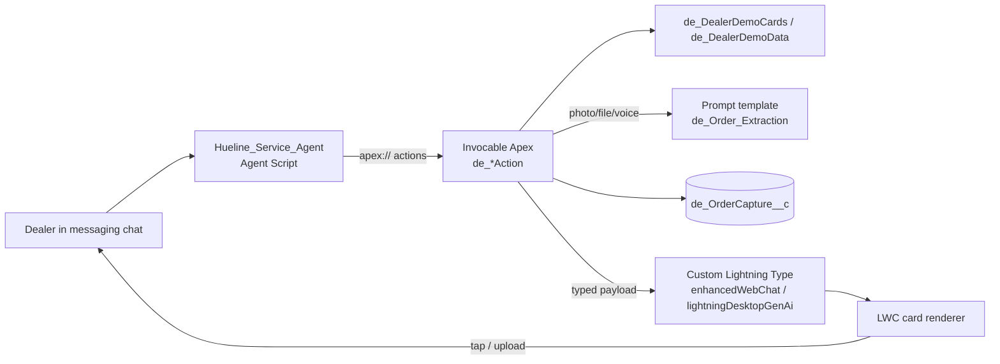

# Dealer Desk

An Agentforce service agent for paint dealers, with 13 rich-card Lightning Types: capture an order from a photo, voice note or file, then track orders, check schemes and credit, and log complaints, all from chat.

"Hueline Paints" is the fictional brand used throughout. All dealers, SKUs, prices and order numbers are made up.

## What it does

The agent (Agent Script `Hueline_Service_Agent`) greets the dealer and shows five tappable activity cards. From there it runs these journeys, each backed by invocable Apex actions that return a typed payload rendered by an LWC:

- **Place an order.** The dealer picks an input method (photo, voice note, file or manual), uploads it, and a prompt template (`de_Order_Extraction`) reads it into catalogue line items. The agent shows an editable order table, recommends top-ups, surfaces scheme-slab gaps and booster products, shows a review card, and places the order.
- **Raise a complaint.** Identifies the recently delivered order, lets the dealer pick a complaint type and affected products, and logs a Case with a ticket card.
- **Track orders**, **view schemes** and **view credit ledger** as dedicated cards.

Demo data (dealer, catalogue, order numbers, scheme figures) is scripted in `de_DealerDemoData` and `de_DealerDemoCards`. Placing an order does not write a real Order yet (see the TODO in `de_PlaceOrderAction`); complaints do attempt a Case insert and fall back to a scripted number.

## Architecture



## Components

### Lightning Types and LWC renderers

| Lightning Type | LWC | Apex payload | Rendered by action |
|---|---|---|---|
| `de_activity_menu` | `de_activityMenu` | `de_ActivityMenuInfo` | `de_ActivityMenuAction` (five activity cards) |
| `de_input_methods` | `de_inputMethods` | `de_InputMethodsInfo` | `de_InputMethodsAction` (photo / voice / file / manual) |
| `de_order_table` | `de_orderTable` | `de_OrderTableInfo` | `de_StartOrderCaptureAction`, `de_AnalyzeOrderAction`, `de_OrderTableAction` (capture UI and editable order table) |
| `de_recommendations` | `de_recommendations` | `de_RecommendationsInfo` | `de_RecommendationsAction` (top-up suggestions) |
| `de_scheme_cards` | `de_schemeCards` | `de_SchemeCardsInfo` | `de_SchemesAction` |
| `de_scheme_boosters` | `de_schemeBoosters` | `de_SchemeBoostersInfo` | `de_SchemeBoostersAction` |
| `de_order_review` | `de_orderReview` | `de_OrderReviewInfo` | `de_OrderReviewAction` |
| `de_order_products` | `de_orderProducts` | `de_OrderProductsInfo` | `de_IdentifyDeliveredOrderAction` (product chips) |
| `de_order_confirmation` | `de_orderConfirmation` | `de_OrderConfirmationInfo` | `de_PlaceOrderAction` |
| `de_order_tracking` | `de_orderTracking` | `de_OrderTrackingInfo` | `de_TrackOrdersAction` |
| `de_ledger_card` | `de_ledgerCard` | `de_LedgerCardInfo` | `de_LedgerAction` |
| `de_complaint_types` | `de_complaintTypes` | `de_ComplaintTypesInfo` | `de_ComplaintTypesAction` |
| `de_ticket_card` | `de_ticketCard` | `de_TicketCardInfo` | `de_CreateComplaintCaseAction` |

### Other pieces

| Piece | Purpose |
|---|---|
| `aiAuthoringBundles/Hueline_Service_Agent` | The agent (Agent Script): router, ordering, complaints, tracking, schemes, ledger topics |
| `genAiPromptTemplates/de_Order_Extraction` | Prompt template that reads a photo/file/text into catalogue line items |
| `de_AddToBasketAction`, `de_OrderState`, `de_OrderAnalysis`, `de_OrderExtraction` | Basket merge, order numbering/state and extraction helpers |
| `de_OrderCaptureController` + `de_OrderCapture__c` | Stores uploaded photo/file/audio/manual capture (chunked) so it can be located server-side |
| `de_custom_chat_header`, `de_cardReveal` | Chat header with logo; shared scroll-into-view and highlight behaviour for freshly rendered cards |
| `pages/de_ChatHost.page` | Test host page for embedded messaging (placeholders, see Configuration) |
| `permissionsets/` | `de_Hueline_Service_Agent` (Apex access) and `de_OrderCaptureGuest` (guest-safe capture access) |
| `demo-test-files/` | Fictional inputs for the order-capture journey (see below) |

### Demo test files

All generated by the scripts next to them, with fictional dealer and products:

- `dealer_handwritten_list.png` : photo of a handwritten 8-line order (upload path).
- `order_sheet_30sep.pdf` and `order_sheet_different.pdf` : printed order sheets (file path).
- `dealer_order_note.m4a` : Hinglish voice note of the same order, made with macOS `say` (voice path).

Regenerate with `python3 generate_demo_files.py`, `python3 generate_different_order.py` (needs Pillow and reportlab) and `zsh generate_voice_note.sh` (macOS).

## Prerequisites

- Salesforce CLI (`sf`) and an org with Agentforce, Agent Script and prompt templates enabled.
- Messaging for In-App and Web (enhanced web chat) to see the `enhancedWebChat` renderers.
- Node.js 18+ only for lint/Jest (`npm install`).

## Setup and deploy

```bash
sf org login web --alias my-org
sf project deploy start --source-dir force-app --target-org my-org
sf org assign permset --name de_Hueline_Service_Agent --target-org my-org
```

Then create/activate the agent from `aiAuthoringBundles/Hueline_Service_Agent` in Agentforce Builder, and add the messaging channel.

## Configuration

| Item | Where | What to set |
|---|---|---|
| Agent user | `Hueline_Service_Agent.agent` `default_agent_user` | Replace `REPLACE_ME@example.com` with your Einstein Agent User. |
| Embedded messaging | `pages/de_ChatHost.page` | Replace `<YOUR_ORG_ID>`, `<YOUR_DEPLOYMENT_DEVELOPER_NAME>`, `<YOUR_SITE_DOMAIN>`, `<YOUR_DEPLOYMENT_PATH>`, `<YOUR_SCRT2_DOMAIN>` from your Embedded Service deployment code snippet. |
| Guest access | `de_OrderCaptureGuest` permission set | Assign to the site Guest User if uploads come through a public site. |
| Branding | `staticresources/deHuelineLogo.png` | Replace with your logo. |

No third-party API keys are used.

## Screenshots

Add screenshots to `docs/screenshots/` (PNG, about 1200px wide) and link them here.

## License

MIT. See [LICENSE](LICENSE).
